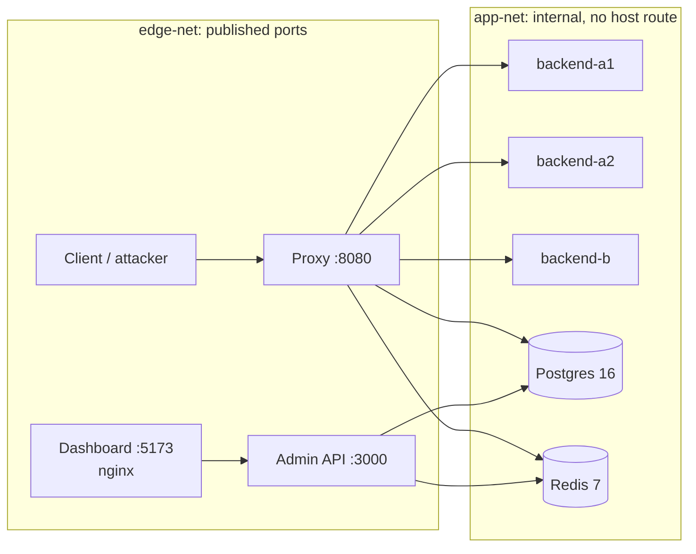
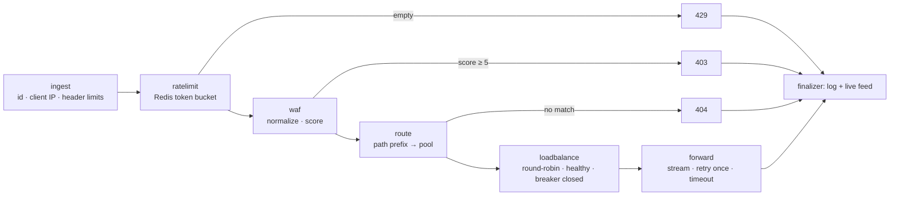
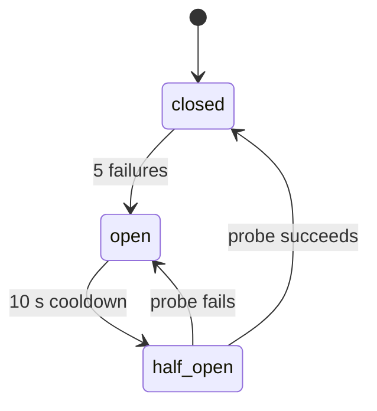

<div align="center">

# DWARPAL

**A self-hosted reverse proxy and web application firewall**

*Build-your-own mini-Cloudflare: every request goes through one pipeline before it reaches a backend*

[Try it in 2 minutes](#try-it-in-2-minutes) · [Architecture](#architecture) · [The WAF](#layer-2-the-waf) · [Testing](#testing)

<!-- Screenshot placeholder: add docs/images/dashboard.png (Live feed or Playground page) and uncomment

-->

*Dwarpal* (द्वारपाल) is Sanskrit for the guardian who stands at the door. Nothing reaches the backends except through it.

</div>

---

## Overview

Most small projects put their API straight on the internet and hope the framework handles bad input. Dwarpal sits in
front of the backends instead and handles every request itself. It checks each one for SQL injection, XSS, path
traversal, command injection and SSRF, rate-limits clients that send too much, and only then streams the request to a
healthy backend and the response back. Nothing is buffered except the request body the WAF has to read.

The backends, Postgres and Redis sit on an internal Docker network with no published port. The only way to reach
them is through the proxy, and that is the threat model the whole project is built around.

For each request, Dwarpal:

1. Assigns a server-generated request ID and resolves the real client IP.
2. Takes a token from that IP's bucket in Redis, or returns 429.
3. Decodes the query, path, headers and body into a canonical form and scores them against the WAF rules.
4. Blocks with a 403 if the score reaches the threshold, or lets it through.
5. Picks a healthy backend for the path, round-robin, skipping any whose circuit breaker is open.
6. Streams the request upstream and the response back, retrying once on a different backend if the first one fails.
7. Logs the result to Postgres and pushes it to the live dashboard, whether it was allowed or blocked.

## Features

| Capability | Description |
|---|---|
| Reverse proxy | Raw `node:http`, streaming both ways with backpressure, hop-by-hop header stripping, request-smuggling (CL+TE) guard |
| Load balancing | Path-prefix routing to backend pools, round-robin over healthy targets, keep-alive agent per upstream |
| Health checks | Probe `/healthz` every 5 s; 2 passes to mark up, 3 failures to mark down |
| Circuit breaker | Per target: 5 failures trip it open, 10 s cooldown, then one half-open probe |
| Retries and timeouts | One bounded retry onto a different backend, 30 s upstream timeout, 25 s graceful drain on SIGTERM |
| WAF | 15 rules over 5 categories, weighted anomaly score, checks query, path, headers and body (incl. gzip/deflate) |
| Input normalization | Decode until stable, NFKC, comment unwrap, `+` → space, so encoded payloads match the same rules |
| SSRF guard | Catches internal addresses written as decimal, hex, octal, shorthand or IPv4-mapped IPv6 |
| WAF modes | `off` / `detect` / `block`, switched live from the dashboard and synced to every instance over Redis pub/sub |
| Rate limiting | Atomic Redis Lua token bucket per client IP: 100 burst, 50/s refill, correct across instances |
| Logging | Batched, non-blocking writes to day-partitioned Postgres; drops rows under overload instead of slowing requests |
| Dashboard | React + Vite: Overview, Live feed, Analytics, Rules, Settings, and a Playground that fires real attacks |

---

## What makes it different

1. **It's a pipeline, not a pile of middleware.** Every stage reads the same request context and returns a verdict: continue, or stop with this response. Adding a feature means adding a stage. Nothing else changes.
2. **Blocked requests are still logged.** Logging runs as a finalizer after the pipeline, not as a stage, so a request stopped at the WAF or the rate limiter is recorded like any other.
3. **The WAF scores instead of matching one regex.** One strong signature blocks on its own. Weak signals only block when several show up together, so `O'Brien` or `select the best option` gets through.
4. **Each part fails the safe way for its job.** The WAF fails closed. The rate limiter fails open. If Redis or Postgres goes down, traffic keeps flowing and only rate limiting and stored logs stop.

> **Decision:** the WAF inspects a normalized *copy* of the input. The original bytes are what get forwarded, so
> normalization can be as aggressive as it needs to be without ever changing what the backend receives.

---

## Architecture

### Network layout



### Request pipeline



> **Decision:** the control plane (admin API, WAF toggle, analytics) runs on its own port, separate from the proxy. A
> request through port 8080 can never reach an admin route.

---

## Tech Stack

| Area | Technology |
|---|---|
| Proxy and admin | Node.js 22, raw `node:http`, plain JavaScript, `ws` for the live feed |
| Storage | PostgreSQL 16, `request_logs` RANGE-partitioned by day |
| Rate limiting and sync | Redis 7 (ioredis), Lua script for the bucket, pub/sub for the WAF toggle |
| Dashboard | React 18, Vite 5, served by nginx |
| Running it | Docker Compose (dev and prod files), Make |
| Attack tools | curl suite, sqlmap, autocannon in their own container |
| Testing | vitest |

---

## Deep Dive: The Layers

### Layer 1: the pipeline kernel

The kernel runs the stages in order. A stage returns nothing (keep going) or a short-circuit with a status and body.
The first short-circuit is written to the client and the loop stops. If a stage throws, the client gets a 500. In
every case the finalizer runs afterwards and records the request. Block pages carry only the request ID, so they leak
nothing about the rules or the backends.

### Layer 2: the WAF

Before matching, every field is folded into a canonical form:

| Trick | Becomes |
|---|---|
| `%252e%252e%252f` (double/triple encoding) | `../`, decoding up to 5 times until nothing changes |
| `UNION/**/SELECT` | `union select` |
| `＜script＞` (fullwidth) | `<script>` via NFKC |

Then every rule is run against every field and the matching scores are added up:

$$\text{anomaly} = \sum_{f \in \text{fields}} \; \sum_{r \in \text{rules}} \text{score}_r \cdot [\,r \text{ matches } f\,], \qquad \text{block} \iff \text{anomaly} \ge 5$$

Strong signatures (`' OR '1'='1`, `<script`, `../`, `$(...)`, an internal IP) score 5 and block alone. Weak ones score
less: a SQL comment marker scores 2, a bare `on…=` scores 3, a shell metacharacter scores 4. A weak one only blocks
when it shows up with something else.

| Category | Rules | Example blocked | Example allowed |
|---|---|---|---|
| SQL injection | 5 | `UNION/**/SELECT pw,id FROM users` | `I love the union of jazz` |
| XSS | 4 | `` | `3 < 5 and 5 > 3` |
| Path traversal | 2 | `%2e%2e%2f%2e%2e%2fetc%2fpasswd` | `reports/2026/summary.pdf` |
| Command injection | 3 | `127.0.0.1;id` | `a=1; b=2; c=3` |
| SSRF | 1 | `http://169.254.169.254/latest/meta-data/` | `https://api.github.com/repos` |

Bodies up to 1 MB are read and inspected, including gzip and deflate (decompression is capped). Anything larger gets
a 413.

> **Decision:** the 15 rules are there to show the engine works, not to cover every attack. Keeping hand-written rules
> ahead of every encoding trick never ends, which is why production WAFs load a maintained ruleset. The rule shape
> (`{id, category, score, pattern | match}`) already fits the OWASP Core Rule Set, and the next step is swapping V8
> `RegExp` for re2, which runs in linear time and can't be ReDoS'd.

### Layer 3: rate limiting

One bucket per client IP, held in Redis and updated by a single Lua script so it's atomic across proxy instances.
With capacity *C* = 100, refill rate *r* = 50/s and *Δt* seconds since the last request:

$$\text{tokens} \leftarrow \min(C,\; \text{tokens} + r\,\Delta t), \qquad \text{allow} \iff \text{tokens} \ge 1, \qquad \text{wait (s)} = \left\lceil \frac{1 - \text{tokens}}{r} \right\rceil$$

Idle buckets expire after one full refill window (*C*/*r* + 1 s).

> **Decision:** the current time is passed into the script instead of read with Redis `TIME`. Scripts that read the
> clock aren't deterministic, which breaks replication.

> **Decision:** the limiter fails open. If Redis is down, requests go through without a limit rather than the whole
> site going down with Redis.

### Layer 4: upstream resilience



Health checks catch a backend that's fully down. The breaker catches one that's up but failing real requests. Health
checks use hysteresis (2 passes to come back, 3 failures to drop out), so one slow probe doesn't take a backend out of
rotation. A failed forward is retried once on a different backend, but only for `GET`, `HEAD` and `OPTIONS` and only if no
response headers have been sent yet. Retrying a `POST` could run it twice.

### Layer 5: logging and the live feed

Every request becomes one row: ID, time, client IP, method, path, upstream, status, duration, decision
(`allow` / `block` / `ratelimit`), rule, category and anomaly score. Rows are buffered and flushed every 500 rows or
every second. If the buffer reaches 5,000 rows, new rows are dropped instead of slowing down requests. The same events
go out over Redis pub/sub and a WebSocket to the dashboard.

> **Decision:** `request_logs` is partitioned by day, and 7 days of partitions are created ahead of time. Deleting old
> logs means dropping a partition instead of running a slow `DELETE`, and queries only scan the days they ask for. A
> partial index on blocked rows keeps the attack queries small.

---

## Results

| Measurement | Value |
|---|---|
| Test suite | **52 tests**, 5 files, all passing |
| Benign lookalikes falsely blocked (WAF corpus) | **0**, tested as a hard gate |
| Blocked SQLi reaching the backend (integration test) | **never**: returns 403 and the upstream stub records nothing |
| Throughput through the full pipeline (stress run) | **~14k requests/s**, p99 **14 ms** |
| Under outages (stress run) | Kept serving through dependency outages: limiter fails open, logging never blocks, health checks fail over, SIGTERM drains |

The stress run combined WAF penetration attempts, sqlmap, protocol abuse, a load storm and dependency outages. No
malformed request crashed the proxy.

---

## Try it in 2 minutes

You don't need to know Docker, `curl` or how a WAF works.

1. Install [Docker Desktop](https://www.docker.com/products/docker-desktop/) and open it.
2. Download this repo (*Code ▸ Download ZIP*) and unzip it.
3. Open a terminal in that folder and run:

   ```bash
   docker compose up -d --build
   ```

   The first run takes a few minutes. It creates the database and seeds a day of demo traffic. (`make try` does this
   and opens the browser.) It uses ports **8080**, **3000** and **5173**.
4. Open **http://localhost:5173/dashboard/playground** and press an attack button: *SQL injection*, *XSS*, *Path
   traversal*. Each sends a real attack to the proxy and comes back **Blocked (403)**.
5. Go to **Settings**, switch the WAF **Off**, and fire the same attacks. Now they get through (200). Switch it back.

Stop everything with `docker compose down`.

### The terminal demo

```bash
make demo         # clean boot + 24 h of seeded history
make curl-suite   # one crafted request per attack class → 403; a harmless lookalike stays 200
make attack       # sqlmap against the proxy: blocks stream in, rate limiting kicks in
make loadtest     # autocannon: still serving under attack
```

Then set the WAF to `off`, rerun `make attack`, and watch sqlmap dump the users table.

---

## Project Structure

```
backend/
  src/core/        pipeline kernel, request context, verdicts
  src/stages/      ingest, ratelimit, waf, route, loadbalance, forward
  src/waf/         rules, normalization, scoring engine, SSRF address checks
  src/proxy/       server, router, balancer, health checks, circuit breaker, retry, lifecycle
  src/ratelimit/   token bucket (Lua) and limiter
  src/obs/         structured logs, metrics, batched Postgres writer, event bus
  src/admin/       admin API and WebSocket feed
  src/db/          pool, migrations, daily partitions, log and analytics queries
  test/            unit (WAF corpus, evasion, normalization) and integration
frontend/          dashboard (React + Vite, served by nginx)
attacker/          curl suite, sqlmap, autocannon
compose.yaml · compose.prod.yaml · Makefile
```

---

## Installation

```bash
git clone https://github.com/ArushJain-697/Dwarpal.git && cd Dwarpal
make init     # create backend/.env from the example
make up       # build and start the stack (waits for health checks)
make migrate  # create the request_logs schema
make seed     # 24 h of history and an attack spike
```

| Make target | Does |
|---|---|
| `up` / `down` / `nuke` | start / stop / wipe the stack |
| `demo` | clean boot + migrate + seed |
| `curl-suite` / `attack` / `loadtest` | drive the demo |
| `restart` | reload the proxy after backend edits |
| `test` | run the backend tests |
| `dev` / `web` | run the proxy / dashboard locally without containers |

All settings are environment variables, checked at startup (see `backend/.env.example`). Postgres and Redis are
optional: without them, logs go to the console only and the rate limiter lets everything through.

---

## Testing

```bash
make test      # or: cd backend && npm test
```

- **WAF corpus:** every malicious payload blocks and every harmless lookalike passes. The false-positive count has to be exactly 0.
- **Evasion and normalization:** double encoding, fullwidth characters, comment splitting.
- **Integration:** the proxy runs in-process in front of a recording stub. A blocked SQLi returns 403 *and never reaches the stub*, which proves the WAF actually stops requests instead of just logging them.

---

## Security notes

- Client IP comes from a trusted-proxy depth; `X-Forwarded-For` is appended to, never trusted.
- Request IDs are generated by the server.
- SSRF: egress allowlist plus address checks after decoding.
- Backend headers are stripped and security headers added.
- Requests with more than 100 headers are rejected.
- Containers run as a non-root user.

---

## Glossary

| Term | Meaning |
|---|---|
| Reverse proxy | A server that takes requests on behalf of backends and forwards them |
| WAF | Web application firewall: inspects HTTP requests and blocks attacks |
| Anomaly score | The sum of scores of every rule that matched; the request is blocked at the threshold |
| Normalization | Decoding and folding input into one form so encoded payloads match the same rule |
| Token bucket | Rate limit where each request spends a token and tokens refill at a fixed rate |
| Circuit breaker | Stops sending traffic to a failing backend for a cooldown, then tests it with one request |
| Hysteresis | Needing several results in a row before changing state, so one blip doesn't flip it |
| Fail open / fail closed | On error, let traffic through / block it |
| SSRF | Server-side request forgery: tricking a server into calling an internal address |
| Finalizer | Code that runs after the pipeline whether or not a stage stopped the request |

